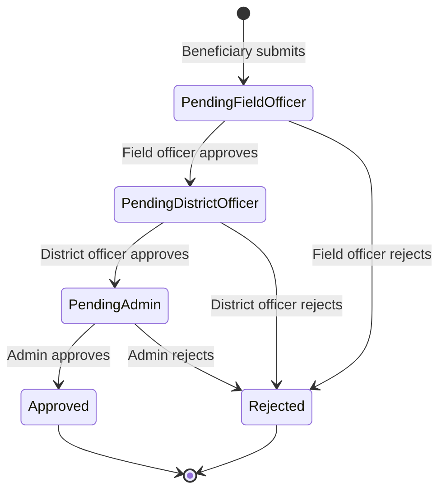
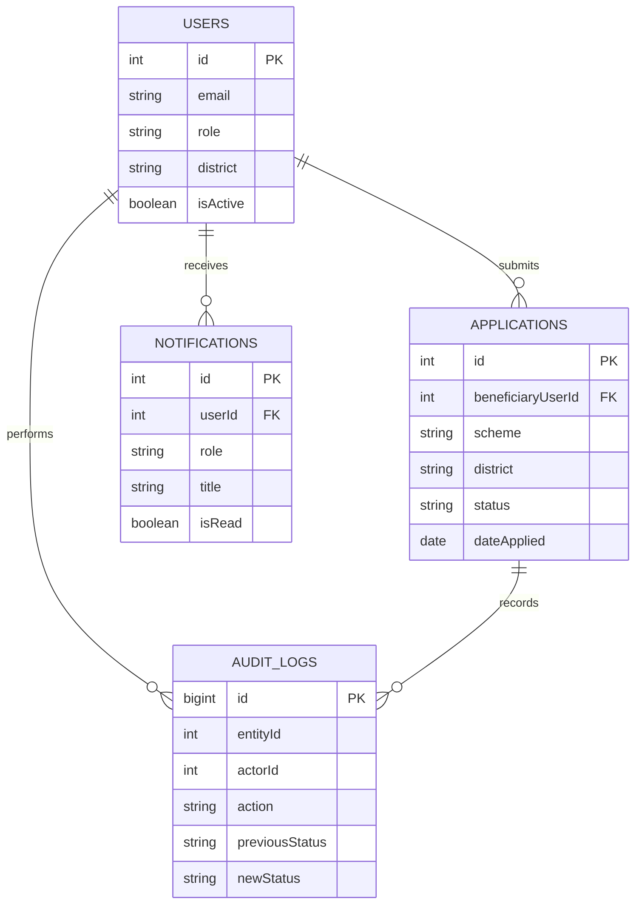

# CivicTrack — Scheme Monitoring System

[](https://github.com/Neemasree/SCHEME-MONITORING-SYSTEM-postgresql-/actions/workflows/ci.yml)

CivicTrack is a student full-stack project for managing public-benefit schemes and reviewing beneficiary applications through a role-based, multi-stage approval workflow.

> **Status:** Portfolio project under hardening; not yet production-ready. CI now applies only compatible npm security updates (never `npm audit fix --force`), checks frontend lint/build and backend syntax/lint, migrations, seeding, PostgreSQL-backed API integration tests, and blocks high/critical dependency advisories. The latest inspected run passed these checks and committed the refreshed lockfiles directly to `main`; a fresh run is validating the resulting repository head. Docker Compose and hosted-deployment templates are provided, but a live deployment has not been verified.

## What it does

- JWT authentication and server-side role checks.
- Beneficiary registration, application submission, status tracking, and review remarks.
- Field Officer → District Officer → Admin review stages, with rejection reasons.
- District-scoped application listings and analytics for officer roles.
- Audit events and a timeline endpoint for application history.
- Recipient-specific notifications when applications move through the workflow.
- Admin user management: create accounts, assign officer districts, list accounts, and deactivate users.
- PostgreSQL-backed dashboard analytics and paginated scheme listing.

## Stack

- **Frontend:** React, Vite, React Router, Axios, Recharts
- **Backend:** Node.js, Express, Helmet, Zod, Swagger UI
- **Database/ORM:** PostgreSQL, Sequelize
- **Authentication:** JWT, bcryptjs
- **Automation:** GitHub Actions, ESLint, Prettier, Husky/lint-staged
- **Local containers:** Docker, Docker Compose, Nginx

## Architecture

```text
React + Vite
    │ HTTPS / JSON + JWT
    ▼
Express REST API ── role and district authorization
    │
    ▼
Sequelize ORM
    │
    ▼
PostgreSQL
```

### Approval workflow



### Data model (current logical relationships)



**Design decisions**
- The API—not the browser—decides which roles may perform each approval transition.
- District scope is derived from the authenticated user's account, not trusted from a request parameter.
- Each approval/rejection is written to an audit log inside the same transaction as the status update.
- Beneficiary accounts can be created publicly, but privileged accounts are provisioned by an administrator.
- Seed data is for local demos only; do not use the demo password or seeded personal details in a public deployment.

## Run locally

### Prerequisites

- Node.js 22+
- PostgreSQL
- Git

### 1. Clone

```bash
git clone https://github.com/Neemasree/SCHEME-MONITORING-SYSTEM-postgresql-.git
cd SCHEME-MONITORING-SYSTEM-postgresql-
```

### 2. Create a PostgreSQL database

For example, in `psql`:

```sql
CREATE DATABASE govt_monitoring;
```

### 3. Configure the backend

Create `backend/.env`:

```env
PORT=5000
DB_NAME=govt_monitoring
DB_USER=postgres
DB_PASSWORD=replace_with_your_local_password
DB_HOST=localhost
DB_PORT=5432
JWT_SECRET=replace_with_a_long_random_secret
CLIENT_ORIGIN=http://localhost:5173
SQL_LOGGING=false
DB_POOL_MAX=10
```

Never commit real credentials or production secrets.

### 4. Install and seed the backend

```bash
cd backend
npm install
npm run migrate
npm run seed
npm run dev
```

The migration runner tracks applied SQL migrations in `SequelizeMeta` and does not intentionally drop existing tables. **Production migration warning:** the current migration runner calls `sequelize.sync()` before applying SQL migrations. Although it does not use `force` or `alter`, this is still model-driven schema creation and should be replaced with an explicit baseline migration plus versioned SQL migrations before production use. Do not run this bootstrap flow against an important production database without reviewing and backing up the schema.

The API listens on `http://localhost:5000` by default. Health check: `GET /health`.

### 5. Start the frontend

In a second terminal:

```bash
cd Frontend
npm install
npm run dev
```

Vite normally serves the UI at `http://localhost:5173`. Set `VITE_API_URL` if the API is hosted elsewhere; its default is `http://localhost:5000/api`.

### Demo accounts

The seed script currently creates these local-only officer accounts:

| Role | Email | Password |
|---|---|---|
| Admin | `admin@govt.in` | `password123` |
| District Officer (Salem) | `district@govt.in` | `password123` |
| Field Officer (Salem) | `field@govt.in` | `password123` |

Register a beneficiary through the UI. New passwords must be at least 12 characters and include uppercase, lowercase, and numeric characters. **Change/remove the seeded demo credentials before any shared or deployed demo.**

## Run the full stack with Docker

Prerequisite: Docker Desktop (or Docker Engine with the Compose plugin).

```bash
docker compose up --build
```

Open the frontend at `http://localhost:8080`. The API is also exposed at `http://localhost:5000`, and its database-aware health endpoint is `http://localhost:5000/health`.

The first startup runs the database migration command automatically. To add local demo users and sample data, open another terminal and run:

```bash
docker compose exec backend npm run seed
```

The default Compose credentials are for local development only. Set `DB_PASSWORD` and `JWT_SECRET` in your shell or an untracked `.env` file before sharing the environment. Never expose the default credentials to the internet. The seed script is not intended for production data.

Stop the stack with `docker compose down`; retain the local database volume. To remove the database volume too, use `docker compose down -v` (this permanently deletes local database data).

## Hosted deployment setup (not yet live)

The repository includes a Render blueprint (`render.yaml`) and Vercel SPA routing configuration (`Frontend/vercel.json`). These are deployment templates only; no live URL or successful hosted end-to-end test is currently verified.

1. **Neon:** create a PostgreSQL database and copy its database name, username, password, and host.
2. **Render:** create a Blueprint deployment from this repository. Set `DB_NAME`, `DB_USER`, `DB_PASSWORD`, and `DB_HOST` from Neon. Keep `DB_PORT=5432`; production mode requires verified PostgreSQL SSL. Set `CLIENT_ORIGIN` to the exact deployed Vercel origin.
3. **Vercel:** import the repository and set the project root to `Frontend`. Add `VITE_API_URL=https://YOUR-RENDER-SERVICE.onrender.com/api`, replacing the example host with the actual Render service URL. Build command: `npm run build`; output directory: `dist`.
4. After both services deploy, open Render's `/health` endpoint, sign in using a newly created demo account, and test beneficiary submission through the full officer workflow.
5. Only then add the actual Vercel URL, API URL, and rotated demo logins to this README. Do not publish default seed credentials or any secret values.

## API overview

All API routes below are under `/api`, except `/health`. Protected routes require `Authorization: Bearer <token>`. Interactive API documentation is available at `/api/docs` when the backend is running.

| Method | Endpoint | Access | Purpose |
|---|---|---|---|
| POST | `/auth/login` | Public | Sign in |
| POST | `/auth/register` | Public | Register a beneficiary |
| GET | `/auth/users` | Admin | List users |
| POST | `/auth/users` | Admin | Create a user |
| PATCH | `/auth/users/:id/deactivate` | Admin | Deactivate a user |
| GET | `/schemes` | Authenticated | List/filter schemes |
| POST | `/schemes` | Admin | Create a scheme |
| GET | `/applications` | Authenticated | List applications within the caller's scope |
| POST | `/applications` | Beneficiary | Apply to an active scheme |
| PUT | `/applications/:id/approve` | Field/District/Admin | Approve, forward, or reject at the permitted stage |
| GET | `/applications/:id/history` | Authorized application viewer | Read the audit timeline |
| GET | `/dashboard/stats` | Admin/Field/District | Summary counts |
| GET | `/dashboard/analytics` | Admin/Field/District | SQL-backed analytics; optional `startDate`, `endDate`, and admin `district` |
| GET | `/performance` | Authenticated | District-level metrics |
| GET | `/notifications` | Authenticated | List recipient notifications |
| PUT | `/notifications/:id/read` | Authenticated | Mark an accessible notification as read |

## CI and verification

GitHub Actions is configured to run:
- ESLint and Vite production build for the frontend.
- Backend JavaScript syntax checks and ESLint.
- High-severity dependency audit gates for both npm projects.
- Schema migration and development seeding against a PostgreSQL 16 service container.
- Jest/Supertest API integration tests for authentication, district isolation, date filters, approval workflow, audit history, beneficiary notifications, invalid input, role denial, and expired tokens.
- A backend coverage report uploaded as a workflow artifact.
- Dependency audit checks. Current audit findings must be resolved before CI can be considered green.

The PostgreSQL integration suite passed in [run 38149401592](https://github.com/Neemasree/SCHEME-MONITORING-SYSTEM-postgresql-/actions/runs/38149401592): backend syntax, lint, migrations, seed, and API tests succeeded; frontend lint and build also succeeded. The overall run failed only at the dependency-audit gates because the current lockfiles still contain known advisories. Check the [latest Actions run](https://github.com/Neemasree/SCHEME-MONITORING-SYSTEM-postgresql-/actions) for any newer result.

## Evidence and deployment status

- **Screenshots/GIF:** to be added after each role is run against a seeded database.
- **Live deployment:** not yet verified. Deployment templates are committed for Vercel and Render; Neon credentials, connected hosting accounts, production environment variables, and a successful live smoke test are still required. This README does not claim a live URL.
- **Repository topics/description:** should be set in GitHub repository settings.

## Security note

This project is not approved for real beneficiary or sensitive personal data. Before production use, verify the database migration strategy, automated integration tests, rate-limit behavior behind the actual proxy, security headers, token/session strategy, backups, privacy review, and deployment secrets. Use a managed PostgreSQL SSL connection and replace all local demo credentials.

## License

Released under the MIT License; see [LICENSE](LICENSE).
