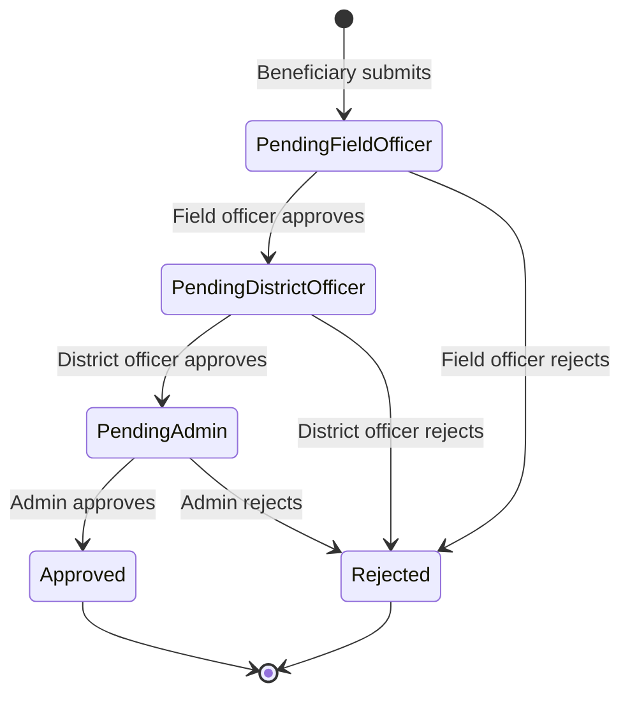
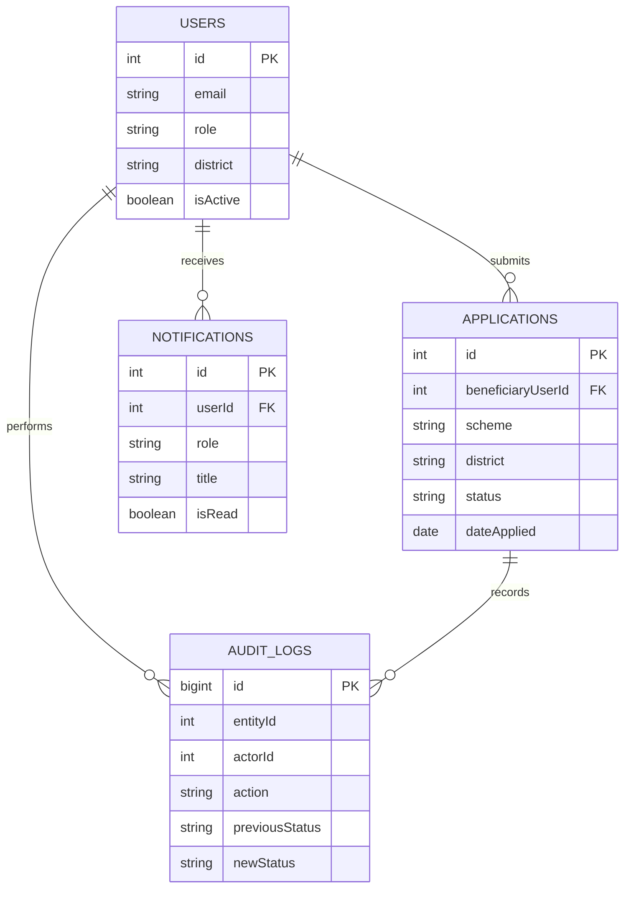

# CivicTrack — Scheme Monitoring System

[](https://github.com/Neemasree/SCHEME-MONITORING-SYSTEM-postgresql-/actions/workflows/ci.yml)

CivicTrack is a student full-stack project for managing public-benefit schemes and reviewing beneficiary applications through a role-based, multi-stage approval workflow.

> **Status:** Development project. CI currently checks frontend lint/build and backend JavaScript syntax. PostgreSQL integration tests, production deployment, and role-specific screenshots are still pending; no live URL is claimed here.

## What it does

- JWT authentication and server-side role checks.
- Beneficiary registration, application submission, status tracking, and review remarks.
- Field Officer → District Officer → Admin review stages, with rejection reasons.
- District-scoped application listings and analytics for officer roles.
- Audit events and a timeline endpoint for application history.
- Recipient-specific notifications when applications move through the workflow.
- Admin user management: create accounts, assign officer districts, list accounts, and deactivate users.
- PostgreSQL-backed dashboard analytics and paginated scheme listing.

## Stack

- **Frontend:** React, Vite, React Router, Axios, Recharts
- **Backend:** Node.js, Express
- **Database/ORM:** PostgreSQL, Sequelize
- **Authentication:** JWT, bcryptjs
- **Automation:** GitHub Actions

## Architecture

```text
React + Vite
    │ HTTPS / JSON + JWT
    ▼
Express REST API ── role and district authorization
    │
    ▼
Sequelize ORM
    │
    ▼
PostgreSQL
```

### Approval workflow



### Data model (current logical relationships)



**Design decisions**
- The API—not the browser—decides which roles may perform each approval transition.
- District scope is derived from the authenticated user's account, not trusted from a request parameter.
- Each approval/rejection is written to an audit log inside the same transaction as the status update.
- Beneficiary accounts can be created publicly, but privileged accounts are provisioned by an administrator.
- Seed data is for local demos only; do not use the demo password or seeded personal details in a public deployment.

## Run locally

### Prerequisites

- Node.js 22+
- PostgreSQL
- Git

### 1. Clone

```bash
git clone https://github.com/Neemasree/SCHEME-MONITORING-SYSTEM-postgresql-.git
cd SCHEME-MONITORING-SYSTEM-postgresql-
```

### 2. Create a PostgreSQL database

For example, in `psql`:

```sql
CREATE DATABASE govt_monitoring;
```

### 3. Configure the backend

Create `backend/.env`:

```env
PORT=5000
DB_NAME=govt_monitoring
DB_USER=postgres
DB_PASSWORD=replace_with_your_local_password
DB_HOST=localhost
DB_PORT=5432
JWT_SECRET=replace_with_a_long_random_secret
CLIENT_ORIGIN=http://localhost:5173
SQL_LOGGING=false
DB_POOL_MAX=10
```

Never commit real credentials or production secrets.

### 4. Install and seed the backend

```bash
cd backend
npm install
npm run seed
npm run dev
```

**Important:** the current development seed command still uses `sequelize.sync({ force: true })`, which drops and recreates tables. Run it only against a disposable local database. Migration-based schema setup is a remaining engineering task.

The API listens on `http://localhost:5000` by default. Health check: `GET /health`.

### 5. Start the frontend

In a second terminal:

```bash
cd Frontend
npm install
npm run dev
```

Vite normally serves the UI at `http://localhost:5173`. Set `VITE_API_URL` if the API is hosted elsewhere; its default is `http://localhost:5000/api`.

### Demo accounts

The seed script currently creates these local-only officer accounts:

| Role | Email | Password |
|---|---|---|
| Admin | `admin@govt.in` | `password123` |
| District Officer (Salem) | `district@govt.in` | `password123` |
| Field Officer (Salem) | `field@govt.in` | `password123` |

Register a beneficiary through the UI. **Change/remove these credentials before any shared or deployed demo.**

## API overview

All routes below are under `/api`, except `/health`. Protected routes require `Authorization: Bearer <token>`.

| Method | Endpoint | Access | Purpose |
|---|---|---|---|
| POST | `/auth/login` | Public | Sign in |
| POST | `/auth/register` | Public | Register a beneficiary |
| GET | `/auth/users` | Admin | List users |
| POST | `/auth/users` | Admin | Create a user |
| PATCH | `/auth/users/:id/deactivate` | Admin | Deactivate a user |
| GET | `/schemes` | Authenticated | List/filter schemes |
| POST | `/schemes` | Admin | Create a scheme |
| GET | `/applications` | Authenticated | List applications within the caller's scope |
| POST | `/applications` | Beneficiary | Apply to an active scheme |
| PUT | `/applications/:id/approve` | Field/District/Admin | Approve, forward, or reject at the permitted stage |
| GET | `/applications/:id/history` | Authorized application viewer | Read the audit timeline |
| GET | `/dashboard/stats` | Admin/Field/District | Summary counts |
| GET | `/dashboard/analytics` | Admin/Field/District | SQL-backed analytics; optional `startDate`, `endDate`, and admin `district` |
| GET | `/performance` | Authenticated | District-level metrics |
| GET | `/notifications` | Authenticated | List recipient notifications |
| PUT | `/notifications/:id/read` | Authenticated | Mark an accessible notification as read |

## CI and verification

GitHub Actions currently runs:
- ESLint and Vite production build for the frontend.
- JavaScript syntax checks for backend files.

The project still needs PostgreSQL-backed integration tests for login, role access, district isolation, and every workflow transition. A green syntax/build workflow alone does not prove database workflows work end-to-end.

## Evidence and deployment status

- **Screenshots/GIF:** to be added after each role is run against a seeded database.
- **Live deployment:** not yet configured. Vercel + Render + managed PostgreSQL and Docker Compose remain follow-up tasks.
- **Repository topics/description:** should be set in GitHub repository settings.

## Security note

This project is not approved for real beneficiary or sensitive personal data. Before production use, complete and verify database migrations, login rate limiting, security headers, short-lived tokens, centralized error handling, automated integration tests, backups, privacy review, and a deployment secrets review.

## License

Released under the MIT License; see [LICENSE](LICENSE).
