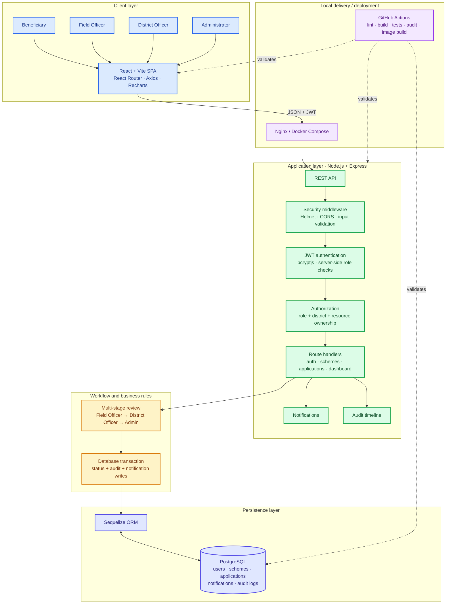
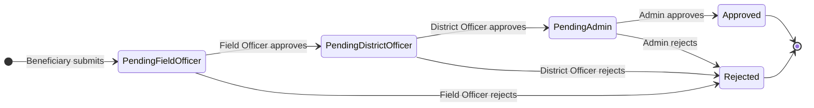
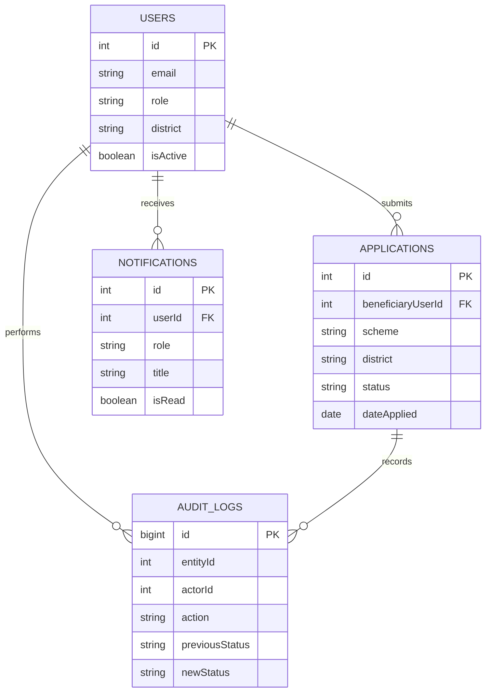
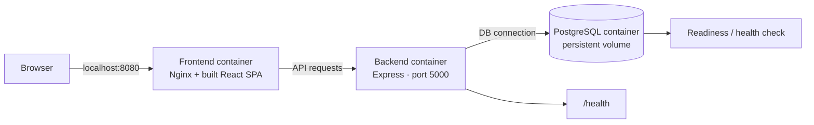

# CivicTrack Architecture

> **Source of truth for the architecture diagrams.** Update this file whenever an implementation change affects the application layers, database relationships, authorization, approval lifecycle, API integration, or deployment topology. Keep the README linked to this document.

## 1. System architecture

### Request and authorization flow

1. A user interacts with the React application.
2. The frontend sends requests to the Express API.
3. The API validates the access token and checks the user's role and resource scope.
4. For officer roles, district scope is derived from the authenticated account; a request parameter must not grant access to another district.
5. The route applies the permitted business transition and writes related state changes in a database transaction where required.
6. Authorized clients can read notifications and application history through their respective API routes.

## 2. Application approval lifecycle

The API enforces which role may approve or reject at each stage. Rejection requires a reason. Status changes, audit records, and related notifications must remain consistent if a transactional write fails.

## 3. Logical data relationships

This is a **logical overview**, not a replacement for the Sequelize models and SQL migrations. If model names, keys, or relationships change, verify the implementation and update this diagram before describing the schema as current.

## 4. Deployment topology

Docker Compose is intended for a local demonstration. GitHub Actions checks frontend lint/build, backend syntax/lint, PostgreSQL-backed integration tests, dependency advisories, Compose configuration, image builds, and a full-stack smoke test. A passing CI run does **not** establish that a hosted deployment is live or production-ready.

## 5. Architecture update checklist

When changing CivicTrack, update this document and the README if the change affects:

- Frontend routes, API endpoints, authentication, or role-specific screens.
- Approval transitions, district scoping, audit history, or notification behavior.
- Sequelize models, SQL migrations, keys, constraints, or transactions.
- Docker services, ports, health checks, reverse proxy, or deployment configuration.
- CI jobs, test coverage claims, setup commands, or verified deployment status.

Keep diagrams grounded in code and tests. Do not add speculative services or claim that a hosted deployment has been verified without evidence.
